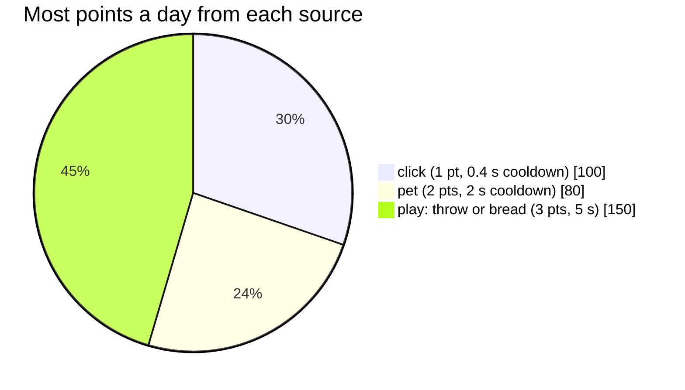
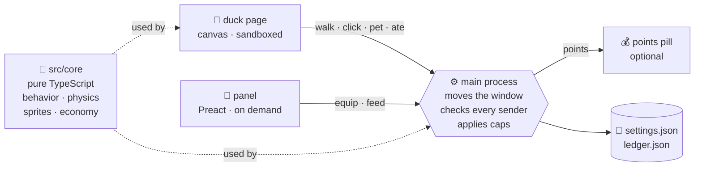
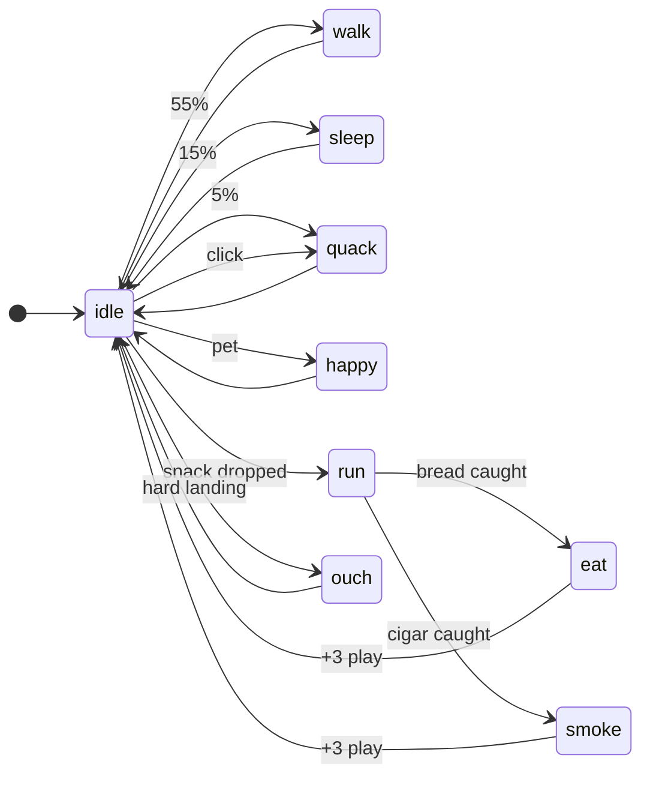

<div align="center">


# DesktopBuddy

**A 16-bit pixel duck that lives on your taskbar.** The programmer's rubber duck: pet it, feed it,
throw it, dress it up. Free and open source, with no paywalls.

[](LICENSE)
[](LICENSE)


<br>


[](https://github.com/Double-bited-Hamburger/DesktopBuddy/commits/main)

### [⬇️ Download for Windows](https://github.com/Double-bited-Hamburger/DesktopBuddy/releases/latest/download/DesktopBuddy-Setup.exe)

<sub>Windows 10 / 11, 64-bit · one click, no admin needed · [all releases](https://github.com/Double-bited-Hamburger/DesktopBuddy/releases)</sub>

[Install](#-install) · [What it does](#-what-it-does) · [How it works](#-how-it-works) ·
[Add a hat](#-add-a-hat-in-5-minutes) · [Roadmap](#-roadmap)

</div>

---

## 🦆 What it does

| You…                                   | The duck…                                  |     Points |
| -------------------------------------- | ------------------------------------------ | ---------: |
| leave it alone                         | idles, blinks, walks the taskbar, naps     |          — |
| **click** it                           | quacks, with a speech bubble               |     **+1** |
| **stroke** it (mouse back and forth)   | closes its eyes happily, a heart pops up   |     **+2** |
| **throw** it (drag fast, let go)       | flies, bounces off the screen edges        |     **+3** |
| drop it from high up                   | lands on its bottom and sees stars ✨      |          — |
| **feed** it bread or a cigar 🚬        | runs/flies to where you drop it, pecks it up, eats or smokes it |     **+3** |
| finish **quests** (3 a day + weekly)   | —                                          | **+10…200** |
| open **gifts** in the Store            | new skins, hats, glasses (odds shown, pity) | spend 80–700 |
| open the **Bag** (right-click)         | wears what you've found, live              |          — |
| run a **focus session** (15/25/50 min) | keeps time while you work                  | **+1/min** |

<div align="center">

<br><sub>6 skins · 4 hats · 2 glasses, all original pixel art, all earnable in play</sub>
</div>

Every source has a **cooldown and a daily cap**, so mashing an auto-clicker gets you nowhere:



## 🚀 Install

**Just want the duck?** Download
[DesktopBuddy-Setup.exe](https://github.com/Double-bited-Hamburger/DesktopBuddy/releases/latest/download/DesktopBuddy-Setup.exe)
and double-click it. That's it: it installs for your user only (no admin password), puts the duck
on your taskbar, and adds a Start menu + desktop icon. Nothing to type, no Node, no npm.

- Windows may say "Windows protected your PC" because the app isn't signed yet: click
  **More info → Run anyway**. Some school or work PCs block unsigned apps completely.
- Updating = download the new version and run it. Your points and items are kept.
- Uninstall from Settings → Apps. Your points stay unless you erase them in the duck's Settings.
- Windows 7 / 8 aren't supported: Electron, which the app is built on, needs Windows 10 or newer.

**Want to change the code?** Build it from source:

```bash
git clone https://github.com/Double-bited-Hamburger/DesktopBuddy.git
cd DesktopBuddy && npm install
npm run dev
```

Needs **Node 24+** and npm. Windows 11 first; macOS/Linux later.
Right-click the duck for the panel · tray icon for **Feed bread**, **Give a cigar**, **Points pill** and **Quit**.

## 🧠 How it works



- **The duck page only asks.** Main checks _which window_ sent each message and applies the
  caps, so a page can never mint points or move another window.
- **The game is pure TypeScript.** Behavior, physics, sprites and economy live in `src/core`,
  free of Electron and the DOM, and are deterministic in tests.
- **Cheap on CPU.** There is no frame loop: the duck wakes only when its picture changes. Main owns
  all window movement, and the panel exists only while it's open.

<details>
<summary><b>The duck's moods</b> (state machine)</summary>



</details>

<details>
<summary><b>Project layout</b></summary>

```
src/core/       pure TS: sprites, animation, behavior, physics, economy, i18n
src/main/       Electron: duck/panel/pill windows, tray, IPC, file storage, points
src/preload/    the only bridge: window.buddy
src/renderer/   duck/ (canvas) · panel/ (Preact) · pill/
assets/src/     .pxl pixel art (text files, one char per pixel)
assets/economy/ economy.json (points, caps) · catalog.json (items)
```

</details>

## 🎩 Add a hat in 5 minutes

Sprites are **plain text**, so art changes are readable in a pull request:

```text
name: my-hat          ← assets/src/hats/my-hat.pxl
size: 14x6
anchor: head 7 5      ← this point sits on the duck's head
palette:
  K #2a1f2d
  G #3f8f4a
  L #6fbf7a
@frame my-hat
....KKKKKK....
...KGLLGGGK...
...KGLGGGGK...
..KGGGGGGGGK..
.KKKKKKKKKKKK.
..............
```

`npm run bake` checks the art rules (≤ 16 colors, no anti-aliasing), then add it to
`assets/economy/catalog.json` and the item name to `assets/i18n/*.json`. Full guide:
[CONTRIBUTING.md](CONTRIBUTING.md#add-a-hat-or-a-face-or-a-toy).

## 🗺️ Roadmap

| Phase                                   | Status |
| --------------------------------------- | :----: |
| 0 · Foundation, security, sprite pipeline | ✅ |
| 2 · Walk, quack, throw, bounce, fall, multi-monitor | ✅ |
| 3 · Skins, hats, glasses, Bag panel     | ✅ |
| 4 · Petting, points & caps, bread, points pill | ✅ |
| 1 · Hand-drawn duck to replace the placeholder | 🎨 |
| 5 · Store, gift boxes (visible odds + pity), quests | ✅ |
| 6 · Opt-in, local focus tracking (Today / Stats) | ✅ |
| 7 · Settings, chiptune sounds, polish   | 🚧 (perf pass left) |
| 8 · Installer, auto-update, contributor guides | 🔜 |
| 9 · Friends (opt-in, self-hostable) — last | 🔜 |

Details and what's still unverified: [docs/ROADMAP.md](docs/ROADMAP.md).

## 🧰 Commands

| Command             | What it does                                        |
| ------------------- | --------------------------------------------------- |
| `npm run dev`       | bake sprites, run with hot reload                   |
| `npm run check`     | typecheck + lint + tests (run before a PR)          |
| `npm run build`     | production bundles (`npm run preview` runs them)    |
| `npm run bake`      | `.pxl` → PNG sheets, validates the art rules        |
| `npm run readme-art`| regenerates the pictures in this README from `.pxl` |
| `npm run dist`      | Windows installer → `release/DesktopBuddy-Setup-*.exe` (Start menu + desktop icon) |

The installer isn't signed yet, so Windows SmartScreen asks once: **More info → Run anyway**.
Linux is planned: see [docs/LINUX.md](docs/LINUX.md).

## 🤝 Principles

🎨 **Original art only**: inspired by other desktop pets, copying none of them ·
🔒 **Private**: no network, no telemetry, focus tracking opt-in and local ·
🎁 **Fair**: no real money, no paywalls, odds always shown ·
🪶 **Light**: one small window at rest

[Architecture](docs/ARCHITECTURE.md) · [Art bible](docs/ART_BIBLE.md) · [Economy](docs/ECONOMY.md) ·
[Privacy](docs/PRIVACY.md) · [Contributing](CONTRIBUTING.md) · [CLAUDE.md](CLAUDE.md) (rules for
AI-assisted development)

<div align="center"><sub>Code <a href="LICENSE">MIT</a> · art and audio CC BY 4.0 · made with 🍞 for ducks</sub></div>
